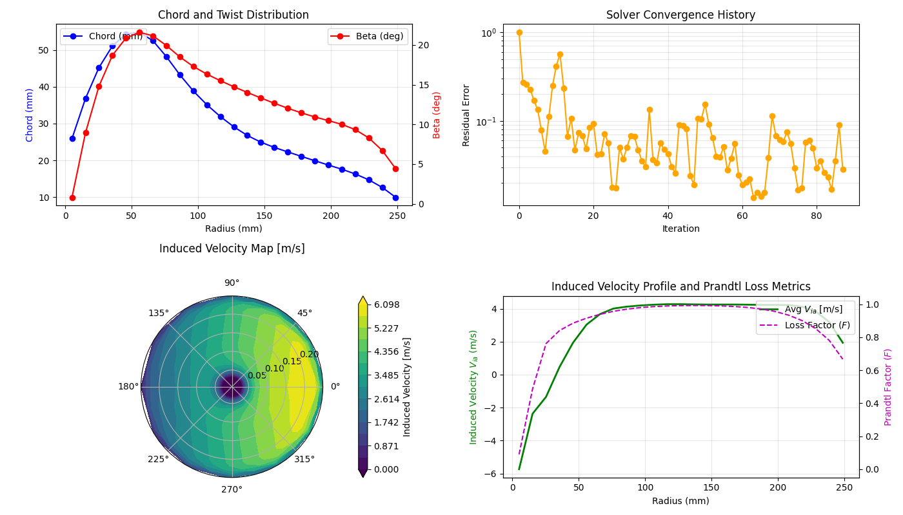

# Proptimiser: A JAX-Accelerated Propeller Optimisation Tool

Proptimiser is an advanced, hardware-accelerated tool for the aerodynamic design, evaluation, and optimisation of propellers using Blade Element Momentum Theory (BEMT). It implements state-of-the-art inflow models alongside physics-informed machine learning (NeuralFoil) and analytical aerodynamic coefficients to find the most efficient propeller geometry for any given set of flight conditions.



By leveraging [JAX](https://github.com/google/jax) for automatic differentiation and Just-In-Time (JIT) compilation, Proptimiser can efficiently optimise a complex solution space using well-established solvers (like L-BFGS-B and SLSQP) to minimise power consumption while adhering to strict structural and flight constraints.

---

## Features

* **Advanced Aerodynamic Modeling:**
  * Uses a generalised inflow model [3] to evaluate arbitrary forward flight, hover, and off-axis conditions.
  * Captures subsonic drag rises using Karman-Tsien/Prandtl-Glauert (PG) compressibility corrections.
  * Predicts tip and root losses via classical Prandtl loss factors.
* **Physics-Informed Aerodynamics:**
  * Utilises Parametric, XFOIL or **NeuralFoil** [9] for airfoil lookups, providing differentiable aerodynamic coefficients ($C_L$, $C_D$, $C_M$) across operational Reynolds and Mach numbers.
  * NeuralFoil is trusted to about ±20° angle of attack (it predicts stall itself) and blends into the Truong 360° post-stall model beyond that, as AeroSandbox does.
* **Parametric Geometry Generation:**
  * Uses the Kulfan Class Shape Transformation (CST) [13] via **AeroSandbox** [5] to create a fully continuous loft of the blade from the structural hub to the aerodynamic tip.
  * Directly exports production-ready `.ibl` surface meshes and mold-split parting lines directly to **Creo Parametric**.
* **JAX-Accelerated Optimisation:**
  * Multi-condition optimisation of motor power subject to thrust, motor power, section thickness and NeuralFoil confidence constraints, using SLSQP (SciPy) or penalised L-BFGS-B (`JAXopt` [8])
  * The induced velocity is solved with blockwise Newton and differentiated exactly by implicit differentiation, so gradients are accurate to machine precision
  * Optimises blade twist ($\beta$), chord ($c$), spanwise CST airfoil sections and operational RPM ($\omega$) simultaneously, with radial ranges of the blade optionally frozen for design purposes.
* **Structural Loads:**
  * Evaluates the shear, bending, torque and axial force along the blade, the pitch-change torque of a constant-speed unit (CSU) and the loads at the hub, for a swept blade or a straight one. It covers rotation, section second moments, aerodynamic loads, and Coriolis and gyroscopic terms (see [Structural Loads](#6-structural-loads)).
  * Adds sweep and rake of the pitch axis, with a matching correction in the BEMT.

---

## Installation

Proptimiser requires Python 3.9+ and uses `pip` for dependency management. Since it relies heavily on JAX, it is highly recommended to run this in a virtual environment.

### 1. Clone the Repository
```bash
git clone [https://github.com/MonashUAS/Propcalc-2_prop-er_faster_stronger.git](https://github.com/MonashUAS/Propcalc-2_prop-er_faster_stronger.git)
cd Propcalc-2_prop-er_faster_stronger
```

### 2. Set Up a Virtual Environment (Recommended)

**On Windows:**

```bash
python -m venv venv
.\venv\Scripts\activate
```

**On Linux/macOS:**

```bash
python3 -m venv venv
source venv/bin/activate
```

### 3. Install Dependencies

Install the required computational and physical libraries:

```bash
pip install -r requirements.txt
```

*(Note: If you plan to use GPU acceleration, ensure you install the CUDA-compatible version of JAX per the [official JAX installation guide](https://www.google.com/search?q=https://jax.readthedocs.io/en/latest/installation.html).)*

---

## CLI & Configuration

Proptimiser is designed to be configured centrally and executed from the command line.

### 1. Configuring a Run

A run is described by three classes in `init.py`:

* **`Inputs`**: solver settings, discretisation, model selection, cost penalties and the flight conditions (one array entry per condition).
* **`BladeSpec`**: the blade definition. `r_foils = [0, r_hub, r_aero, r_mid..., r_tip]` splits the blade into a structural hub (`r < r_hub`, outside the BEMT domain), a blend zone (`r_hub <= r < r_aero`, a structural transition that the BEMT does not solve and that carries no force) and the aerodynamic zone, where CST airfoil sections are defined at `r_foils[2:]` and interpolated along the span. `freeze` holds radial ranges (m) where chord, twist or CST sections keep their seed values during optimisation. `offset_r`, `offset_y` and `offset_z` give the sweep and rake of the pitch axis (see [Structural Loads](#6-structural-loads)), and `mat_*` and `fill_factor` give the blade material.
* **`Propeller`**: a design (chord, twist, CST sections) plus the `Inputs` and `BladeSpec` it is analysed with. It builds the solver parameters and handles all saving and loading.

```python
from init import Inputs, BladeSpec, Propeller

inputs = Inputs(
    thrust_target=[29.6, 22.5],   # Target Thrusts (N)
    V_x=[8.60, 0.0],              # Forward Velocity (m/s)
    V_yz=[12.29, 0.0],            # Crosswind/Off-axis Velocity (m/s)
    omega=[445.0, 400.0],         # Rotor speeds (rad/s)
)
blade = BladeSpec(
    r_foils=(0.0, 0.025, 0.05, 0.15, 0.275),  # [0, r_hub, r_aero, r_mid, r_tip] (m)
    airfoils=("arad10",),                     # seed airfoil for each aero station
    freeze={"c": [(0.05, 0.08)]},             # hold the chord at its seed value between 50 and 80 mm
)
prop = Propeller.default(inputs=inputs, blade=blade)     # or Propeller.from_apc("apc_prop_data/propgeom_data/20x8-PERF.PE0")
```

#### Optimisation problem

Every quantity the optimiser sees is non-dimensionalised by a physical reference from the specification, so no weights are needed to balance them:

| | Definition | Meaning |
|---|---|---|
| Objective | $J = \sum_i w_i P_i \,/\, \sum_i w_i P_{ideal,i}$ | Motor power relative to the ideal (actuator disc) power of the thrust targets. The denominator depends only on the flight conditions, so $J$ is the mission energy (`objective_weight` = time fractions) made dimensionless, roughly 1/efficiency. |
| Thrust | $\lvert T_i/T_i^* - 1 \rvert \le$ `thrust_tol` | Each condition within its thrust band. |
| Motor power | $P_i \le$ `P_max` | Motor limit. |
| Thickness | $t/c \ge$ `min_tc` | At every optimised CST section (buildability). |
| Confidence | NeuralFoil confidence $\ge$ `min_confidence` | One per condition: the mean over the aerodynamic zone, with each blade element weighted by its force scale $V_R^2 c\,dr\,d\psi$. Errors in the section coefficients reach thrust and power in that proportion. Held as $\log(\text{confidence}/\text{min\_confidence}) \ge 0$, which keeps a gradient where NeuralFoil's sigmoid saturates at zero. `0` disables. |

Every constraint is written as a margin relative to its own limit (`-0.01` = limit exceeded by 1% of itself).

* **`SLSQP`** (default) treats the constraints exactly.
  * *Phase 1:* if the seed violates a constraint, it first restores feasibility by minimising the sum of squared relative violations.
  * *Phase 2:* SLSQP runs in design variables scaled by the exact curvature of the objective at that point (Jacobi scaling, computed once from the Hessian diagonal), so its initial Hessian estimate has the right size in every direction. SciPy's SLSQP stops when a linearisation of the constraints is incompatible. In that case the solver restarts from the best feasible design with a fresh Hessian, as long as the previous attempt improved that design.
* **`L-BFGS-B`** handles only bounds, so the constraints become quadratic penalties weighted by `w_thrust`, `w_thickness` and `w_confidence`. These weights are used by L-BFGS-B only.

Both solvers stop when the objective changes by less than `opt_tol` (relative) in an iteration, or after `opt_max_iter` iterations.

The induced velocity is solved by damped Newton on each annulus. The BEMT residual Jacobian is block diagonal, since every annulus only sees its own induced velocity, so each Newton iteration costs one forward-mode pass per solved component. It converges to `V_i_0_eps` (non-dimensional residual, default `1e-8`) in a handful of iterations, and `jax.lax.custom_root` makes the gradients of the converged solution exact. An annulus that is already converged takes no step. An annulus where 10 step halvings find no decrease is heading into a minimum of the residual norm that is not a root (a fold of the residual past stall, or reversed flow near the hub in forward flight). Newton stops there, and a bracketed fallback solves that annulus: for a trial axial inflow it solves the torque balance for the swirl, then it moves the axial inflow to balance the thrust. Both scalar roots stay bracketed (Illinois regula falsi), so the fallback always ends on a root. It solves up to 4 annuli at a time on a copy of the blade that holds only those annuli, and it runs only when an annulus needs it.

Solver output is controlled per solver in `Inputs`:

* `opt_verbose` (outer optimiser):
  * `0` prints the start banner and final summary only.
  * `1` (default) adds an iteration table every `opt_print_every` iterations.
  * `2` also prints the constraint margins, the load-weighted and lowest-station NeuralFoil confidence, and JAXopt's internal L-BFGS-B line.
* `V_i_0_verbose` (induced velocity Newton solve):
  * `0` (default) is silent.
  * `1` prints one line per solve (thrust target, Newton iterations, annuli solved by the bracketed fallback, final residual).
  * `2` also prints every Newton iteration and the sectional thrust.

Propeller files written before format 3 load with the Broyden-era `V_i_0_eps`, `V_i_0_max_iter` and `opt_tol` replaced by the new defaults (a warning says so).

Chord and twist in the blend zone are always derived from the hub values (`hub_chord`, `hub_twist_deg`) and the first aerodynamic station, so the analysed blade matches the exported CAD. With NeuralFoil (`coeff_method = 3`) the CST sections are also design variables, kept buildable by a minimum thickness constraint (`BladeSpec.min_tc`) and inside NeuralFoil's trusted region by the confidence constraint.

### 2. Graphical Interface

```bash
python app.py                 # start from the default propeller
python app.py Currawong_V1    # open propellers/Currawong_V1.json
```

The window has three tabs sharing one propeller, with a log panel underneath that shows everything the solvers print:

* **Setup:** edit the flight conditions, solver, model, motor and penalty settings (`Inputs`) and the blade definition, bounds, frozen ranges, sweep and rake, and material (`BladeSpec`). **Apply** rebuilds the propeller, and invalid settings are reported next to the Apply button.
* **Design:**
  * **Evaluate all conditions** solves every flight condition and shows thrust, power and efficiency per condition.
  * The results are shown as the live-plot panels, the 2x2 diagnostics, and a per-station table (angles, C_L, C_D, Re, dT, dQ) that can be copied or exported as CSV.
  * **Structural** shows the loads along the blade and at the hub, the stress and safety factor, and a per-station table. The **Motion** fields set the spin acceleration, the pitch rate and acceleration of the blade, and the airframe rates. **Recalculate** reruns the structural loads only.
  * **Planform** lets you drag spline control points to reshape chord and twist.
  * **3D & Export** renders the blade and writes the Creo `.ibl` mold, core insert and parting surface.
  * **Blend saved propellers** averages saved designs.
* **Optimise:** **Start** and **Stop** the optimiser while the plots and per-condition table update live. **Use as current design** takes the result back to the Design tab for checking, smoothing and export.

**File** menu: open or save propeller files and import APC `.PE0` geometry.

### 3. Running the Optimisation via CLI

Execute the main optimisation loop by running:

```bash
python init.py
```

* **Live plots:** A Matplotlib window updates the convergence plots, induced velocity fields, airfoil sections and blade shape at every reported solver step.
* **Terminal Output:** An aligned table reports the objective (power relative to ideal), the largest constraint violation, the relative change and, for each flight condition, omega, thrust against target, motor power and P/P_ideal, followed by a final summary. Press Ctrl+C once to stop after the current iteration. `python results.py` also prints a structural summary for each flight condition.
* **Exporting:** Upon convergence (or hitting the maximum iteration limit), the CLI will prompt: `Save Propeller? (y/n)`. Selecting `y` saves the propeller, its `Inputs` and `BladeSpec` to `propellers/<name>.json`.

Saved propellers are reloaded with `Propeller.load("<name>")`. Files are plain JSON with named fields, so they can be read and diffed, and new fields never break old files. `prop.with_inputs(...)` and `prop.with_blade(...)` re-use a saved design with new flight conditions, discretisation or blade zones. Propellers saved in the old `.eqx` format are converted once with `Propeller.from_legacy_eqx("<name>").save("<name>")`.

### 4. Results and Post-Processing

* **Multi-Condition Performance Verification:** Feeds saved propeller data back into the propeller modelling data to evaluate a fixed propeller geometry at arbitrary flight conditions.
* **Geometric Smoothing Runs:** Provides a manual override to run control-point smoothing and evaluates effect on blade.

---

```text
--- Evaluating 2 Flight Conditions ---
Resolving Induced Velocity Field for all conditions...
Cond: 0   | Omega: 445.00 | Motor Pwr: 1250.42 | Thrust: 29.61 | MIL RMS: 0.1240
Cond: 1   | Omega: 400.00 | Motor Pwr: 940.15  | Thrust: 22.48 | MIL RMS: 0.0891
```
---

### 5. Geometry Exports

Converts propeller geometry into CAD exports and 3D solid mesh generation.


* **Hub Planform Correction:** Extrapolates aerodynamic data down to the true spin center ($r=0$). This structurally modifies the root chord and twist to prevent center gaps or self-intersections during solid CAD modeling.
* **3D Solid Mesh Generation:** Interpolates continuous Class Shape Transformation (CST) airfoil sections along a 3D quarter-chord pitch axis to construct a polygonal model for rapid local rendering.
* **Tooling & Ply Construction (`.ibl` Exports):** Outputs native Creo-compatible curve tables for three distinct manufacturing targets:
* *Aerodynamic Mold:* The exact external outer mold line (OML) boundary.
* *Internal Insert:* An automatically offset internal core dimension adjusted for composite skin laminate thickness, used for a 3D printed insert.
* *Parting Surface:* The 3D leading and trailing edge spatial trace defining the split line for molding halves.

The exporters place every section's pitch-axis point on the swept axis (`offsets`). They cut the sections at constant radius, in the plane normal to the radial line, while the aerodynamic sections are normal to the swept span. The exported chord of a section whose span turns by an angle $L$ away from the radial line is therefore longer by $1/\cos L$ (1.5% at 10 deg, 15% at 30 deg).

---

### 6. Structural Loads

`structure.py` evaluates the loads along the blade and at the hub of the solved flight conditions. It solves nothing itself. The aerodynamic loads come from the stored induced velocity. The cost is about one evaluation of the airfoil coefficients: 2 ms at 20 radial and 12 azimuthal stations with NeuralFoil. A cold BEMT solve takes 63 ms and a warm-started one 3 ms. All functions are `jit`, `vmap` and `grad` safe, so a structural limit can become an optimiser constraint later.

```python
import propmodel, results, structure

prop, params_list, rows = results.evaluate_conditions(prop)                # solves the induced velocity
data = results.structural_data(params_list[0], prop.material())            # numpy arrays for plots and tables
print(results.structural_summary(data, 0))

# differentiable form, one flight condition
V_i, _ = propmodel.induced_velocity(params)
result = structure.structural_loads(params, prop.material(), V_i=V_i)       # loads along the blade and at the hub
stress = structure.stress_fields(result, prop.material())                   # stress and safety factor
```

#### Method

| Part | Method | Result |
|---|---|---|
| Section | Strip integrals of the CST outline (Gauss nodes in the chordwise angle) | Area, centroid, $I_{xx}$, $I_{zz}$, $I_{xz}$, torsion constant $J = A^4/(40 I_p)$ |
| Inertia | Every blade slice is a rigid body that follows the hub (spin, airframe rates) and the pitch change. $F = -m'a$ and $M = -(J'\dot\omega_s + \omega_s \times J'\omega_s)$, with $a = \dot\omega_h \times p + \omega_h \times (\omega_h \times p) + 2\,\omega_h \times (\nu \times p) + \dot\nu \times p + \nu \times (\nu \times p)$ | Centrifugal, Euler, Coriolis and gyroscopic loads, and the centrifugal twisting moment $\tfrac12 \omega^2 (I_{zz}-I_{xx})\sin 2\beta$ |
| Statics | Force summation from the tip to the root with 3D position vectors (trapezoid rule). It is exact for any sweep, because a cantilever blade is statically determinate | Axial force, shear, flap and edgewise moment, torque at every station and azimuth |
| Hub | The root loads of the $N$ blades, summed on the hub frame by Fourier series over the azimuth (only multiples of $N$ per revolution survive) | Thrust, torque, side forces, hub moments and their $N$/rev amplitudes |
| Stress | $\sigma = N/A + a_x x + a_z z$ at the outline points (the product of inertia is included), torsion $T t_{max}/J$ and shear, von Mises, divided by the fill factor | Safety factor against `mat_sigma_allow` and `mat_tau_allow` |

The pitch-change torque of a CSU is the moment about the radial axis through the hub centre. It has an aerodynamic part (ATM) and an inertial part. The inertial part holds the centrifugal twisting moment (CTM) and the pitch-acceleration terms. The hold torque is $-(\text{ATM} + \text{CTM})$.

A rigid blade in steady rotation has no Coriolis load. The term is nonzero for the pitch rate (a CSU at work, set in `structure.Kinematics`) and for the airframe rates (gyroscopic loads). It would also be nonzero for flap and lag rates. Those need an aeroelastic time model that this code does not have.

#### Frames and signs

* Blade frame $(e_r, e_t, e_z)$, right-handed: $e_r$ radial at the root azimuth, $e_t$ the direction of blade motion, $e_z$ the thrust direction. The shaft turns at $+\omega\,e_z$.
* Section axes $(x_s, s, z_s)$: the chord direction at the section twist (leading to trailing edge), the span direction, and the normal toward the suction side. They match the CAD axes of the exported blade (X chordwise, Y radial, Z thrust).
* Positive twist $\beta$ and positive $C_M$ are nose-up, a rotation about $+s$. Positive twist lifts the leading edge toward $+e_z$.
* Hub frame: $x$ at azimuth 0, $y$ at 90 deg, $z = e_z$. The hub loads are the loads of the blades on the hub, so the torque the shaft supplies is minus the hub moment about $z$.
* `structural_loads` returns the force and moment that the blade outboard of each station applies to the blade inboard of it. Axial force is positive in tension.

#### Inputs

* **Material** (`BladeSpec`): one isotropic material over the CST outline. The fields are `mat_density` (kg/m³), `mat_E` and `mat_G` (Pa), the allowables `mat_sigma_allow` and `mat_tau_allow` (Pa, 0 means $\sigma/\sqrt3$) and `fill_factor`. The defaults follow the APC propeller files (specific gravity 1.7, E 19.7 GPa). The allowables are placeholders: set them from the real material. A fill factor below 1 is a homogenised infill. Mass and stiffness scale with it, and the stress in the material is the gross stress divided by it. A hollow moulded shell is stiffer for its mass than this, so the model is conservative for it.
* **Sweep and rake** (`BladeSpec`): `offset_r` (control radii, m), `offset_y` (tangential offset of the pitch axis, positive toward the direction of rotation, as APC `SWEEP`: a backswept tip has a negative offset) and `offset_z` (axial offset, positive toward the thrust side, as APC `RAKE`). Empty offsets are an unswept blade. The offsets are fixed geometry, not optimiser variables. A PCHIP spline joins the control points. The offsets are held outboard of the last point and taper to zero at the hub centre inboard of the first point. `Propeller.from_apc(path, use_apc_sweep=True)` takes them from an APC file. It puts the pitch axis a quarter chord behind the leading-edge parting line.
* **Motion** (`structure.Kinematics`): spin acceleration, pitch rate and acceleration of the blade about its axis, and the airframe rates (p, q, r). All are zero by default.

#### Sweep in the BEMT

The station radius stays the polar radius from the rotation axis, so the BEMT annuli keep their radii. A swept blade (`ModelConfig.swept`) takes a section frame normal to its pitch axis. The relative velocity along the span is dropped (the independence principle, as in AeroDyn 15). Lift and drag act normal to the span. The load per unit radius carries the factor $ds/dr$ of the span. With zero offsets the formulas equal the unswept ones, and a test pins this. An unswept blade runs the original code. The correction is first order. It has no vortex-method validation. It uses the polar radius in the Du-Selig and tip-loss corrections. The effect on thrust is second order in the sweep angle. The moment arms of the loads are exact.

#### Limits

* The blade is rigid. There is no elastic deflection, centrifugal stiffening or untwist, and no fatigue, vibration or flutter model.
* The shear centre is the centroid, and $J$ is an approximation (within 10% for a thin section). The model has no laminate: use `fill_factor` for an equivalent solid.
* The hub stub inside `r_hub` has no mass. The root station carries the root loads, and the blade root is the first station.
* The section area of the CST model sits about 6% below the APC 10x6 Clark-Y sections outboard, and lower in the thick moulded root and the rounded tip. Check the root, which governs the safety factor.
* With the Prandtl loss on, the blade-element loads have no loss factor, so the structural thrust is above `thrust()` near the tip. This is conservative.
* The azimuth grid resolves the harmonics below `n_psi / 2`. Use 24 or more azimuth stations for hub spectra.
* `tilt` is not wired into the aerodynamics, so it does not change the loads.

---

##  References

The underlying aerodynamics and solver mathematics are built upon the following literature:

[1] S. Mancini, K. Boorsma, G. Schepers, and F. Savenije, “A comparison of dynamic inflow models for the blade element momentum method,” *Wind Energ. Sci.*, vol. 8, no. 2, pp. 193–210, Feb. 2023, doi: 10.5194/wes-8-193-2023.

[2] W. Zhong, T. Wang, W. Z. Shen, and W. J. Zhu, “A function improving tip loss correction of blade-element momentum theory for wind turbines,” *International Journal of Sustainable Energy*, vol. 43, no. 1, p. 2352794, Dec. 2024, doi: 10.1080/14786451.2024.2352794.

[3] W. Khan and M. Nahon, “A propeller model for general forward flight conditions,” *International Journal of Intelligent Unmanned Systems*, vol. 3, no. 2/3, pp. 72–92, May 2015, doi: 10.1108/IJIUS-06-2015-0007.

[4] P. Yu, J. Peng, J. Bai, X. Han, and X. Song, “Aeroacoustic and aerodynamic optimization of propeller blades,” *Chinese Journal of Aeronautics*, vol. 33, no. 3, pp. 826–839, Mar. 2020, doi: 10.1016/j.cja.2019.11.005.

[5] P. Sharpe, “AeroSandbox: A Differentiable Framework for Aircraft Design Optimization,” Massachusetts Institute of Technology, 2021. Accessed: Jun. 24, 2026. [Online]. Available: https://hdl.handle.net/1721.1/140023

[6] J. V. R. Prasad, Y.-B. Kong, and D. Peters, “ANALYTICAL METHODS FOR MODELING INFLOW DYNAMICS OF A COAXIAL ROTOR SYSTEM”.

[7] Y. LENG, M. BRONZ, T. JARDIN, and J.-M. MOSCHETTA, “Comparisons of Different Propeller Wake Models for a Propeller-Wing Combination,” p. 15 pages, 2019, doi: 10.13009/EUCASS2019-147.

[8] “JAXopt — JAXopt 0.8 documentation.” Accessed: Mar. 26, 2026. [Online]. Available: https://jaxopt.github.io/stable/

[9] P. Sharpe and R. J. Hansman, “NeuralFoil: An Airfoil Aerodynamics Analysis Tool Using Physics-Informed Machine Learning,” Mar. 20, 2025, arXiv: arXiv:2503.16323. doi: 10.48550/arXiv.2503.16323.

[10] “Optax — Optax documentation.” Accessed: Dec. 15, 2025. [Online]. Available: https://optax.readthedocs.io/en/latest/#

[11] D. M. Pitt and D. A. Peters, “THEORETICAL PREDICTION OF DYNAMIC-INFLOW DERIVATIVES.,” *Vertica*, vol. 5, no. 1, pp. 21–34, 1981.

[13] B. M. Kulfan, "Universal Parametric Geometry Representation Method," *Journal of Aircraft*, vol. 45, no. 1, pp. 142–158, 2008, doi: 10.2514/1.29958. *(Used by AeroSandbox for the CST interpolation from the structural hub to aerodynamic stations).*

And more! (will write up into a thesis/paper soon...)